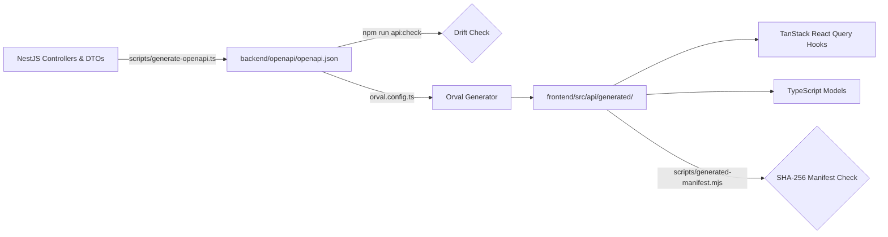
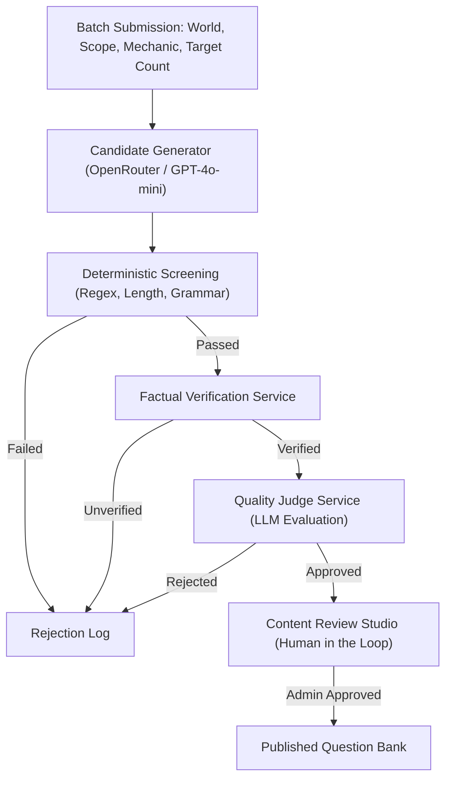

# Akwaan Architecture

Akwaan (أكوان) is an Arabic social party game platform built as a high-performance, feature-first modular monolith. The frontend and backend are structured as separate npm workspaces inside a single monorepo, with shared configuration, Docker orchestration, and workspace scripts driven from the repository root.

```text
akwaan/
├── frontend/   # Next.js 15 App Router web application (Host/Display + Mobile Player + Admin Studio)
├── backend/    # NestJS 10 modular API, Socket.io real-time engine, MongoDB persistence, Content Engine
└── ai/         # OpenCode content-authoring workspace (skills, roles, validators)
```

---

## Architectural Principles & Layering

### Frontend Architecture
- **Dependency Flow**: `app route -> feature public API -> feature hook / API -> shared HTTP client / Socket.io client`.
- **Composition-Only Routes**: Next.js App Router route components only compose feature modules and layouts; they contain no direct transport logic or persistence queries.
- **Server State Management**: `@tanstack/react-query` owns server state caching, background invalidation, and data hydration.
- **Real-Time Synchronisation**: `socket.io-client` subscribes to authoritative live-session state streams. A dedicated 4 Hz clock context isolates timer ticks from expensive component tree re-renders.
- **Configuration Boundary**: Runtime environment variable access is strictly centralized in `src/config`.

### Backend Architecture
- **Dependency Flow**: `controller / gateway -> application service -> domain policy / validator -> repository / contract -> infrastructure provider`.
- **Persistence Isolation**: Controllers and WebSocket gateways never query Mongoose directly. Feature repositories encapsulate all persistence queries.
- **Modular Monolith Boundaries**: Cross-feature communication occurs via explicit service and repository interfaces rather than internal schema coupling (e.g., Games queries Questions via repository boundaries without registering the Question model).
- **External Integration Ports**: AI agents and media providers implement abstract ports. Normal local verification runs against deterministic in-memory fakes with zero live external network calls.

---

## Feature Domains & Ownership

| Domain | Scope & Responsibilities |
| :--- | :--- |
| **Authentication & Users** | Credential validation, bcrypt hashing, JWT issuance and verification, role-based guards, user persistence, subscription validity, and idempotent administrator bootstrapping. |
| **Catalogs & Worlds** | Canonical World definitions, Scope taxonomies, catalog slugs, banners, localization, ordering, and deletion safety guards. |
| **World Content & Questions** | Curated question persistence, challenge mechanics configuration, lifecycle states (draft, approved, published), asset repair use cases, and exemplar datasets. |
| **Live Game Sessions** | Room lifecycle, room codes, dual-screen participant management (Host/TV display vs. Mobile controllers), real-time WebSocket gateways, and participant-private state projections. |
| **Match Engine** | Board progression (12 positions across 3 Worlds with 4 Scopes each), turn management, scoring rules, answer verification, and challenge lifecycle convergence. |
| **Music & Audio** | Curated uploaded-track library, audio snippet planning, Arabic answer normalization, and FFmpeg/FFprobe media processing boundaries. |
| **Content Engine (AI)** | Offline multi-agent authoring pipeline: Generation Planning, Candidate Generation, Deterministic Screening, Factual Verification, Quality Judging, and Human Review Studio. |

---

## Real-Time Engine & Live Match State

Live multiplayer matches are driven by a strict **server-authoritative state machine** running across NestJS WebSocket gateways (`LiveGameSessionsGateway`) and the Match domain engine:

1. **Optimistic Concurrency & Revision Fencing**:
   - Every live session and match mutation carries an authoritative sequence number (`expectedRevision` vs. `actualRevision`).
   - Concurrent modifications are rejected with explicit conflict statuses (`MATCH_CONCURRENT_MODIFICATION`), guarding against concurrent write conflicts.
2. **Client-Side Packet Suppression & Rollback Prevention**:
   - The frontend suppresses incoming WebSocket events whose revision tokens have already been applied or superseded.
   - Out-of-order packets cannot roll client state backwards, maintaining consistent UI state on mobile controllers and host screens.
3. **High-Frequency Timer Isolation**:
   - High-frequency countdown ticks run in an isolated 4 Hz React clock context. Components consuming match time subscribe to the clock without triggering re-renders of the full board or score state.
4. **Hot-Path Performance Optimizations**:
   - **State Convergence Sweeper**: Replaced recursive per-runtime queries with a single projected status query, reducing obligation resolution from **~925 KB over 78 round trips to ~3 KB over 1 operation**.
   - **Snapshot Composition**: Eliminates redundant Match reconciliation on converged states, reducing healthy active snapshot database queries from **3 operations to 1**.
   - **Deadline Synchronization**: Reuses in-memory commit state, dropping persistence operations on interaction mechanics from **3 to 0** (Bomb: 3 to 2).
   - **Socket Acknowledgements**: Strips redundant state snapshots from acknowledgements, returning lightweight revision tokens while state broadcasts occur via dedicated rooms.

---

## API Contract & OpenAPI Pipeline

Akwaan enforces an **OpenAPI-first, fully typed contract pipeline** bridging the NestJS backend and Next.js frontend:



1. **Contract Generation**:
   `npm run api:openapi` spins up a controller-only Swagger reflection graph (`scripts/openapi-app.module.ts`) requiring no database connection or cloud services, generating `backend/openapi/openapi.json`.
2. **Contract Validation**:
   `npm run api:check` executes `check-openapi-offline.mjs` and `validate-openapi.ts`, verifying that the committed OpenAPI specification is valid, properly typed, and free of drift.
3. **Client Generation via Orval**:
   `npm run api:generate` invokes Orval (`frontend/orval.config.ts`), transforming the OpenAPI spec into fully typed TanStack React Query hooks, mutations, and TypeScript DTO models with custom Axios transport wrappers (`src/api/orval-mutator.ts`).
4. **Drift Quality Gate**:
   `npm run api:generate:check` calculates SHA-256 hashes of all generated artifacts against `scripts/generated-manifest.json`. Any manual edits or out-of-sync generated clients cause `api:generate:check` (and `npm run verify`) to report drift.

---

## AI Content Engine Architecture

The Content Engine is an offline, multi-stage authoring system designed to generate culturally authentic, mechanically valid Arabic quiz content:



- **Committed Architecture**:
  - **Candidate Generator**: Queries OpenRouter models (`openai/gpt-4o-mini`) using structured JSON outputs matching mechanic-specific schema constraints.
  - **Deterministic Screening**: Fast regex, script, and length validation before running factual verification.
  - **Factual Verification**: Validates entity existence and question facts against curated knowledge sources.
  - **Quality Judge**: LLM-as-judge scoring for challenge suitability, cultural appropriateness, and Arabic phrasing.
  - **Billing Safety & Defensive Guardrails**: Ambiguous HTTP errors and network dropouts are strictly classified as billing-ambiguous to prevent double-charging; no automatic retries on paid provider boundaries; per-batch and monthly SAR budget caps are enforced in the application layer.
  - **Human-in-the-Loop Review Studio**: No AI-generated candidate is automatically written to active gameplay tables. Every candidate must pass through the administrative review studio (`/admin/content-engine`) for human verification.
- **In-Development Modules (Track B1)**:
  - **Generation Planner**: Formulates mechanic-native generation plans from World and Scope profiles.
  - **Authoring Target Resolver**: Normalizes mechanic slugs, alias resolutions, and exemplar datasets.

---

## Verification & Quality Gates

Deterministic verification can be run locally before pushing or merging code:

```bash
npm run verify
```

`npm run verify` executes:
1. `npm run lint` — ESLint verification across frontend and backend.
2. `npm run typecheck` — TypeScript compiler checks across all workspaces (`tsc --noEmit`).
3. `npm run test` — Frontend Vitest unit/mapper tests and backend Jest domain/application tests.
4. `npm run api:check` — OpenAPI specification drift and structural validation.
5. `npm run api:generate:check` — Orval generated client SHA-256 manifest integrity check.
6. `npm run api:migration:check` — Catalog migration and database schema consistency guards.
7. `npm run build` — Production compilation of both frontend (Next.js) and backend (NestJS).

Extended verification (`npm run verify:full`) runs dockerized integration suites and full Playwright browser E2E test suites against ephemeral databases (`akwaan_e2e_test`).
