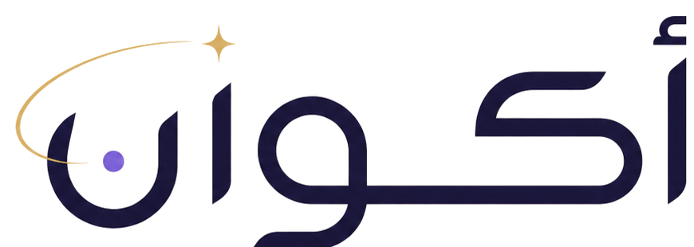
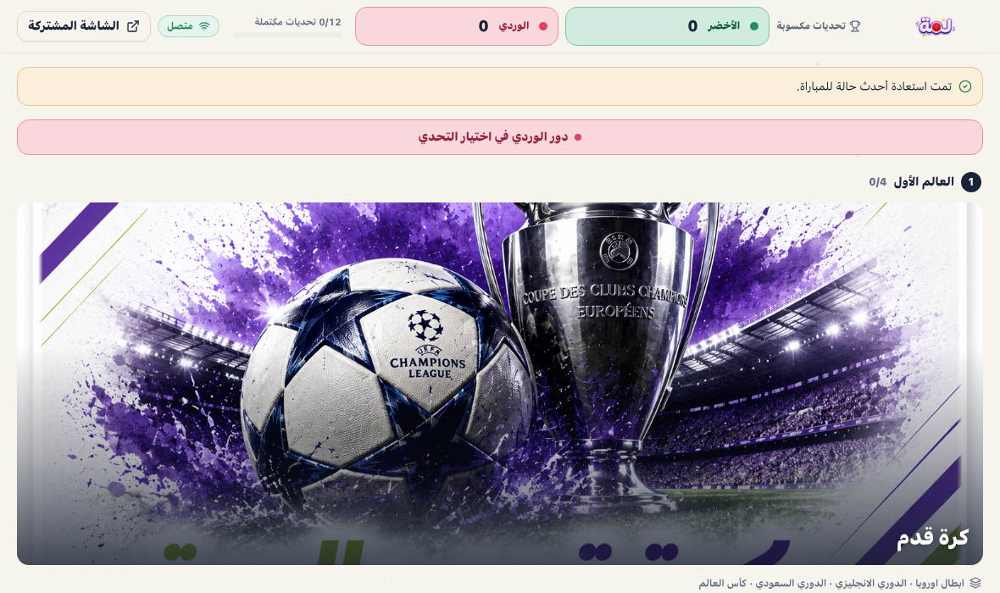
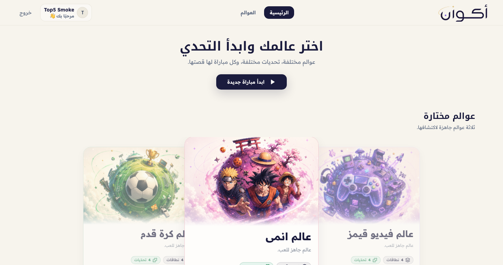
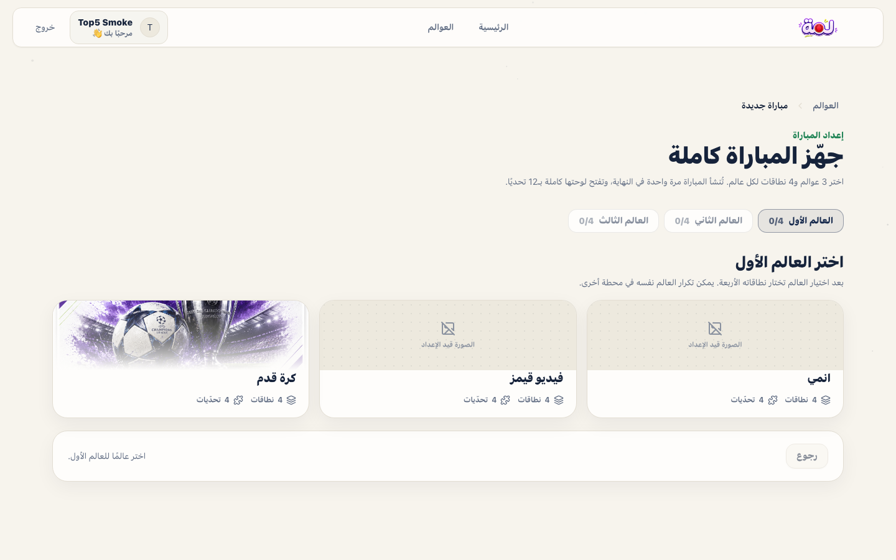
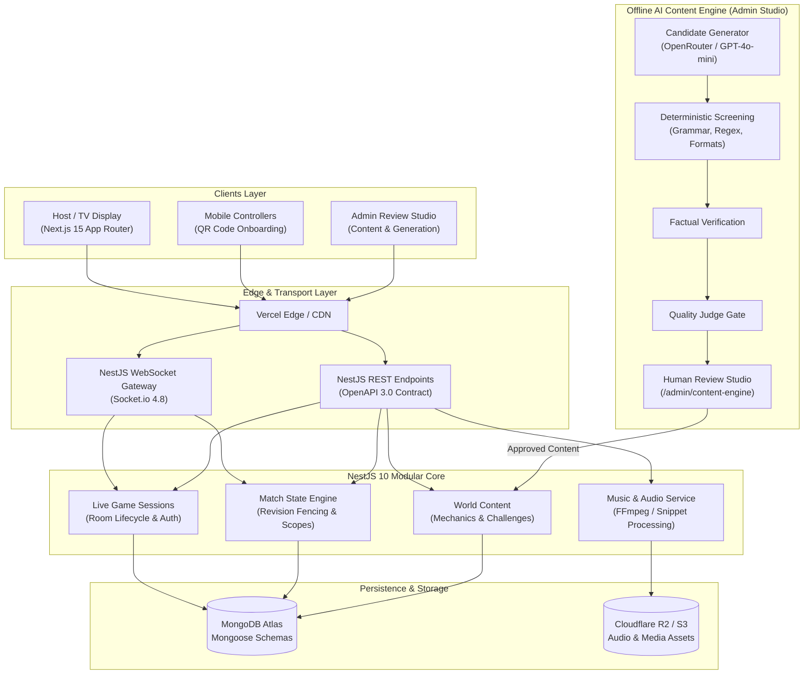
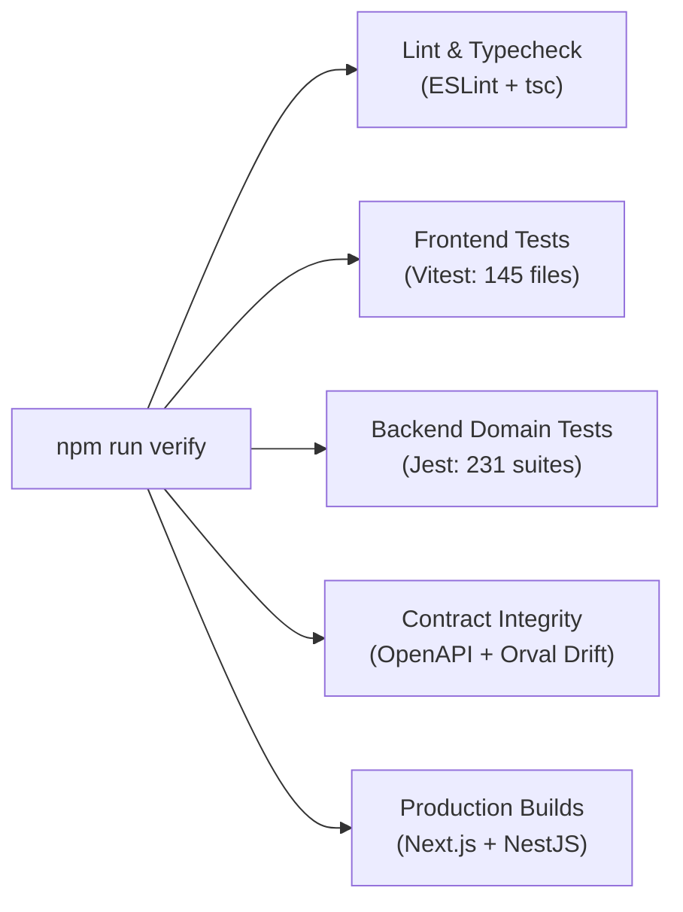

<div align="center">



# أكوان — Akwaan

### Real-Time Arabic Multiplayer Party Game & Interactive Challenge Platform

[](https://www.typescriptlang.org/)
[](https://nextjs.org/)
[](https://nestjs.com/)
[](https://socket.io/)
[](https://www.mongodb.com/)
[](ARCHITECTURE.md#api-contract--openapi-pipeline)

<p align="center">
  A high-concurrency, real-time Arabic party gaming platform engineered with a server-authoritative state machine, dual-screen WebSocket synchronization (Host TV & Mobile Controllers), and an offline multi-agent AI content generation engine with strict human-in-the-loop review.
</p>

[**Live Web App**](https://akwaan-frontend.vercel.app) • [**Production API Health**](https://akwaan-api.onrender.com/health) • [**Architecture Guide**](ARCHITECTURE.md) • [**Testing Strategy**](TESTING.md) • [**System Roadmap**](GAME_NEW_SYSTEM_ROADMAP.md)

</div>

---

## Highlights at a Glance

- **Dual-Screen Party Architecture**: A shared TV/host screen displays live boards, animations, audio cues, and challenge resolutions, while players interact seamlessly on mobile web browsers via zero-friction QR code onboarding (no app installation required).
- **Server-Authoritative State Engine**: Strict optimistic concurrency with revision fencing (`expectedRevision` vs. `actualRevision`) and client-side out-of-order packet suppression, designed to guard against race conditions and historical state rollback.
- **Measured Hot-Path Performance**:
  - **99.7% payload reduction**: State convergence sweeper optimized from **~925 KB over 78 round trips to ~3 KB over 1 operation**.
  - **Database read reduction**: Snapshot composition skips redundant reconciliation on converged states, reducing queries from **3 operations to 1**.
  - **Zero persistence latency**: In-memory deadline synchronization dropped persistence operations from **3 to 0** on active interaction mechanics.
- **OpenAPI-First & Zero-Drift Type Safety**: Backend NestJS decorators compile into OpenAPI 3.0 via a controller-only reflection graph; Orval generates type-safe TanStack React Query hooks and DTOs; SHA-256 manifests enforce zero drift on every build.
- **Offline AI Content Engine**: Cultural and mechanic-native Arabic content authoring with multi-stage verification (candidate generation via OpenRouter / GPT-4o-mini, deterministic rule screening, factual verification, LLM quality judge gating, and an administrative human review studio).
- **Comprehensive Automated Test Coverage**: Extensive test suites across both frontend and backend workspaces (145 Vitest test files in frontend, 231 Jest test suites in backend), covering domain state machines, concurrency guards, and API contract integrity.

---

## Visual Showcase

<div align="center">

### Interactive Live Match Board
*12-position game board spanning 3 chosen Worlds with 4 Scopes each, team turn bands, and dynamic score tracking.*



<br/><br/>

### Worlds & Scopes Catalog
*Curated cultural worlds spanning Saudi heritage, Arabic cinema, puzzles, music, and general knowledge.*



<br/><br/>

### Pre-Match Setup Wizard
*Host customization workflow allowing teams, game rules, and world selections before server match initialization.*



</div>

---

## System Architecture

Akwaan is structured as a feature-first modular monolith within an npm monorepo:



---

## Engineering Highlights & Technical Depth

### 1. Real-Time State Synchronization & Revision Fencing
In a high-energy party game, network jitter and concurrent user actions (e.g. buzzer races, simultaneous answers) cannot compromise state integrity.
- **Server-Authoritative State Machine**: Client devices never calculate scores or decide turn progression. Every mutation flows through `LiveGameSessionsGateway` and the `Match` engine.
- **Optimistic Concurrency & Revision Fencing**: Match records carry monotonic revisions. Commands supply `expectedRevision`. If concurrent requests clash, the engine rejects stale writes with `MATCH_CONCURRENT_MODIFICATION`, re-syncs, and reconciles deterministically.
- **Client Out-of-Order Packet Suppression**: Mobile and host clients maintain an authority revision watermark across session, runtime, and match contexts. Dropped or late WebSocket packets arriving out of order are rejected, preventing historical rollbacks.
- **High-Frequency Timer Decoupling**: Game countdown timers operate on a dedicated **4 Hz React clock context**. Tick events update timer consumers directly without triggering re-renders of heavy board layouts or DOM subtrees.

### 2. Measured Hot-Path Performance Optimizations
*(Corroborated in commit `4f33704`)*
- **State Convergence Sweeper**: Replaced recursive per-runtime scans with a single projected status query bound by lifecycle status rather than document age. Reduced network transfer and payload size from **~925 KB over 78 round trips to ~3 KB over 1 operation**.
- **Snapshot Composition**: Skip redundant Match reconciliation on converged runtime states using data already loaded in the snapshot. Healthy active snapshot operations dropped from **3 database round trips to 1**, bypassing write paths entirely.
- **Deadline Synchronization**: In-memory commit reuse allows interaction mechanics (e.g. buzzer and multi-choice challenges) to drop persistence operations from **3 to 0** (Bomb mode: **3 to 2**).
- **Socket Acknowledgements**: Stripped duplicate state snapshots from command acknowledgements. Responses return lightweight identity and revision tokens, relying on room-level WebSocket multicasting for unified state delivery.

### 3. OpenAPI-First Contract Generation & End-to-End Type Safety
Akwaan eliminates frontend/backend type divergence through an automated, strictly validated pipeline:
1. **Controller-Only Reflection**: `npm run api:openapi` spins up `scripts/openapi-app.module.ts`—a lightweight Swagger reflection graph that exports `backend/openapi/openapi.json` without requiring live database connections or network services.
2. **Offline Drift Check**: `npm run api:check` validates that the committed OpenAPI specification matches controller decorators and schema rules.
3. **Orval Client Generation**: `npm run api:generate` transforms the OpenAPI spec into fully typed TanStack React Query hooks, mutations, and models in `frontend/src/api/generated/`.
4. **SHA-256 Manifest Verification**: `npm run api:generate:check` calculates SHA-256 hashes of generated code against `scripts/generated-manifest.json`. Manual tampering or uncommitted API updates cause `npm run api:generate:check` (and `npm run verify`) to report drift.

### 4. Offline AI Content Engine
To ensure high question quality and cultural authenticity in Arabic, Akwaan decouples content creation from live gameplay:

#### Published Baseline (Committed in Repository)
- **Candidate Generator**: Generates mechanic-native Arabic challenge candidates via OpenRouter (`openai/gpt-4o-mini`).
- **Deterministic Screening**: Fast regular-expression and structural filters validate character limits, punctuation, Arabic script requirements, and mechanic schema compliance.
- **Factual Verification**: Validates entity veracity and answer accuracy against curated reference datasets.
- **Quality Judge Gating**: An LLM-as-judge assesses humor, cultural fit, difficulty balance, and Arabic linguistic phrasing.
- **Defensive Billing Safety**: Explicit HTTP status allowlists prevent unhandled provider errors from auto-retrying on paid LLM APIs. Per-batch (2 SAR) and monthly (25 SAR) budget caps are enforced in the application layer.
- **Human-in-the-Loop Review Studio**: Web workspace (`/admin/content-engine`) for administrative inspection, manual edits, and human approval before draft publication into the active question bank.

#### In Development (Track B1 Branch)
- **Automated Generation Planner**: Decomposes World and Scope taxonomies into structured prompt generation batches.
- **Authoring Target Resolver**: Resolves canonical mechanic slugs, alias mappings, and exemplar contexts dynamically.

---

## Core Game Mechanics

Akwaan offers a diverse suite of Arabic-native party game mechanics designed for social fun, quick wit, and team rivalry:

| Mechanic | Arabic Name | Description & Dynamics |
| :--- | :--- | :--- |
| **المرحلة** | *Marhala* | Progressive clue trivia. Teams race against the clock as clues reveal increasingly specific hints, rewarding early risk-taking with higher points. |
| **القنبلة** | *Bomb* | High-pressure speed challenge. Teams alternate naming valid category items under a shrinking fuse timer; the team caught when the bomb explodes loses. |
| **اقرأ خصمك** | *Read Your Opponent* | Asymmetric psychological challenge. One team predicts how the opposing team's chosen player will answer a subjective or dilemma question. |
| **الأقرب** | *Closest* | Numerical estimation. Both teams submit secret numerical estimates (e.g. historical dates, statistics, distances); the team closest to the exact value wins. |
| **توب 5** | *Top 5* | Ranked or unranked list deduction. Teams take turns identifying top 5 items in a defined domain (e.g. most visited cities, highest grossing films). |
| **ركّبها** | *Rakkibha* | Visual shape-matching collaboration. Teams describe silhouettes and spatial patterns from private reference views to identify the matching puzzle piece. |
| **لا تحرقها** | *La Tahriqha* | Taboo deduction mechanic where players describe a target secret term without uttering forbidden clue words. |
| **اكشفني** | *Ekshifni* | Progressive image tile reveal challenge where visual puzzle clues are uncovered step-by-step. |
| **من أول نغمة** | *First Note* | Auditory quiz mechanic where teams bid on the shortest audio snippet duration needed to recognize regional melodies. |
| **القطعة الدخيلة** | *Odd Piece* | Visual pattern recognition where players inspect sets of themed vehicle or object images and identify the incongruous intruder. |
| **إكس أو المتحركة** | *Moving XO* | Strategic tic-tac-toe variant combined with trivia questions to earn tactical board placements. |

---

## Tech Stack

| Category | Technologies & Tools |
| :--- | :--- |
| **Frontend Framework** | **Next.js 15.1** (App Router), **React 18.3**, **TypeScript 5.3** |
| **State & Data Fetching** | **@tanstack/react-query 5.28** (Server State), **React Context** (Isolated 4 Hz Clock) |
| **Styling & Animation** | **Tailwind CSS 3.4**, **Radix UI**, **Lucide Icons**, **GSAP 3.15** |
| **Real-Time Transport** | **Socket.io Client 4.8.1**, **Axios 1.6** |
| **Backend Framework** | **NestJS 10.4**, **Express Platform**, **RxJS 7.8** |
| **WebSockets** | **@nestjs/websockets**, **@nestjs/platform-socket.io** |
| **Persistence & Database** | **MongoDB Atlas**, **Mongoose 8.0** |
| **Cloud & Media** | **Cloudflare R2** / S3 SDK (`@aws-sdk/client-s3`), **FFmpeg & FFprobe** |
| **API Contract & Tools** | **NestJS Swagger / OpenAPI 3.0**, **Orval 7.13**, **Zod 3.22** |
| **AI & LLM Services** | **OpenRouter API** (OpenAI GPT-4o-mini), **@google/genai**, Model Context Protocol (`@modelcontextprotocol/sdk`) |
| **Testing & Quality** | **Vitest 1.6**, **Jest 29.7**, **Playwright 1.55**, **Testing Library**, **ESLint**, **Prettier** |
| **DevOps & Containers** | **Docker**, **Docker Compose**, **Vercel** (Frontend), **Render** (Backend API) |

---

## Monorepo Structure

```text
akwaan/
├── frontend/                       # Next.js web application
│   ├── src/
│   │   ├── app/                    # App Router routes (player, admin, match, dev)
│   │   ├── features/               # Feature-sliced domains
│   │   │   ├── live-game-session/  # Dual-screen match UI, board, and challenge frames
│   │   │   ├── challenge-explainer/# Visual mechanic walkthroughs & tutorial dialogs
│   │   │   ├── ai-generation/      # Content Engine candidate review & admin studio
│   │   │   ├── world-management/   # Worlds, Scopes, and challenge type catalog editors
│   │   │   ├── auth/               # Authentication forms and session hydration
│   │   │   └── categories/         # Content taxonomy management
│   │   ├── api/                    # Typed API client
│   │   │   ├── generated/          # Orval-generated React Query hooks & models
│   │   │   └── orval-mutator.ts    # Custom Axios mutator with auth & envelope handling
│   │   └── test/                   # Vitest unit, component, and mapper test suites
│   ├── e2e/                        # Playwright end-to-end browser tests
│   └── orval.config.ts             # Orval contract generation configuration
├── backend/                        # NestJS modular API & real-time server
│   ├── src/
│   │   ├── modules/
│   │   │   ├── live-game-sessions/ # WebSocket gateway, room state, and actor projections
│   │   │   ├── match/              # Board progression, scoring, and revision reconciliation
│   │   │   ├── content-engine/     # Multi-agent offline AI generation, screen & judge
│   │   │   ├── world-content/      # Curated questions, mechanics, and exemplar data
│   │   │   ├── music/              # Audio tracks, snippet planning, and answer normalization
│   │   │   ├── auth/               # Passport JWT, password hashing, and role guards
│   │   │   └── users/              # User persistence and subscription policies
│   │   ├── common/                 # Swagger config, filters, interceptors, and validators
│   │   └── infrastructure/         # Media inspection, audio storage, and LLM transport
│   ├── openapi/                    # Committed backend/openapi/openapi.json specification
│   ├── scripts/                    # OpenAPI reflection, validation, and migration scripts
│   └── test/                       # Jest integration, media, and fixture suites
├── ai/                             # OpenCode content-authoring workspace
│   └── .opencode/                  # Skills, roles, knowledge bases, and authoring manifest
├── docs/                           # Architecture specs, phase designs, and expansion plans
├── docker-compose.yml              # Local development compose stack
├── docker-compose.test.yml         # Isolated test compose stack (ephemeral MongoDB)
└── package.json                    # Monorepo workspace configuration & scripts
```

---

## Getting Started

### Prerequisites

- **Node.js**: `v20.x` or later
- **npm**: `v10.x` or later
- **Docker & Docker Compose**: Required for local MongoDB and containerized integration tests
- **FFmpeg / FFprobe**: *(Optional)* Required locally only for live audio snippet processing (included automatically in Docker test containers)

### Quick Start (Local Development)

1. **Clone the repository**:
   ```bash
   git clone https://github.com/MuathAlkathiri/akwaan.git
   cd akwaan
   ```

2. **Install monorepo dependencies**:
   ```bash
   npm install
   ```

3. **Configure environment variables**:
   ```bash
   cp backend/.env.example backend/.env
   cp frontend/.env.example frontend/.env.local
   ```
   *Edit `backend/.env` with your MongoDB connection string, JWT secrets, and optional AI provider keys.*

4. **Start the development servers**:
   ```bash
   npm run dev
   ```
   - **Frontend**: `http://localhost:3001`
   - **Backend API**: `http://localhost:3000` (Swagger docs at `/docs`)

Alternatively, run each workspace independently:
```bash
npm run dev:backend    # NestJS on :3000 with hot-reload watch
npm run dev:frontend   # Next.js on :3001
```

### Docker Development Stack

```bash
docker compose up -d --build    # frontend :3001, backend :3002, mongo :27017
docker compose config           # validate configuration before starting
docker compose down             # stop containers (do NOT pass -v: preserves database volume)
```

> [!IMPORTANT]
> **Database Name & Volume Integrity**: The MongoDB database name is pinned as `lammah-quiz` (which holds historical production content). Docker volumes (`lammah-game_mongodb_data` and `lammah-game_backend_uploads`) are named explicitly in `docker-compose.yml` to survive directory renaming. Never pass `-v` to `docker compose down` on persistent environments.

---

## Testing & Quality Assurance

Akwaan adheres to a multi-tiered testing strategy spanning unit, domain, integration, and browser end-to-end verification:



### Primary Verification Commands

| Command | Description |
| :--- | :--- |
| `npm run verify` | **Local Full Verification**: Runs linting, typechecking, frontend Vitest tests, backend Jest tests, OpenAPI drift check, Orval client drift check, migration check, and production builds. |
| `npm run verify:full` | Runs `verify` plus dockerized backend integration tests, media tests, and full Playwright E2E browser tests. |
| `npm run test` | Runs unit and domain tests across both frontend and backend. |
| `npm run test:frontend` | Runs 145 Vitest test files (1,667 tests) in jsdom environment. |
| `npm run test:backend` | Runs 231 Jest test suites (2,820 tests) with mocked providers. |
| `npm run test:backend:integration` | Runs HTTP integration tests against an ephemeral `_test` MongoDB database. |
| `npm run test:e2e` | Runs Playwright browser tests covering dual-screen match flows and admin navigation. |

> [!NOTE]
> **Jest Execution on macOS**: When running the complete backend suite locally on multicore macOS environments, bounding worker concurrency (e.g. `npm run test:backend -- --maxWorkers=2`) ensures smooth parallel execution and prevents OS-level worker process crashes.

### API Contract Verification

```bash
npm run api:openapi        # Regenerate backend/openapi/openapi.json via reflection graph
npm run api:check          # Validate committed OpenAPI specification against schema rules
npm run api:generate       # Regenerate frontend/src/api/generated from OpenAPI spec
npm run api:generate:check # Ensure no contract drift or manual modifications via SHA-256
```

---

## Documentation Index

- [**ARCHITECTURE.md**](ARCHITECTURE.md) — Comprehensive architectural principles, modular monolith boundaries, real-time sync, and OpenAPI pipeline.
- [**TESTING.md**](TESTING.md) — Detailed guide to test tiers, fixtures, ephemeral test databases, and Playwright E2E execution.
- [**GAME_NEW_SYSTEM_ROADMAP.md**](GAME_NEW_SYSTEM_ROADMAP.md) — Canonical product roadmap, mechanic specifications, and implementation phases.
- [**deployment/README.md**](deployment/README.md) — Production VM deployment, Oracle Cloud setup, Caddy reverse proxy, and environment provisioning.
- [**ai/.opencode/README.md**](ai/.opencode/README.md) — OpenCode content authoring workspace, agent skills, and prompt authoring guidelines.
